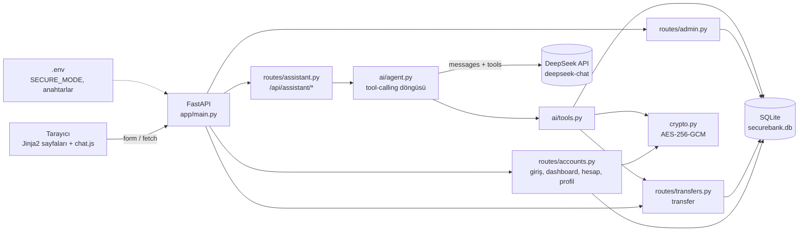

# Mimari

## Bir asistan isteğinin yolu

1. `chat.js` mesajı `POST /api/assistant/chat` ile gönderir. Oturum cookie'si (imzalı) kullanıcıyı belirler.
2. `agent.chat()` mesaj listesini kurar:
   - açık mod: system prompt + geçmiş + mesaj tek bir metin
   - güvenli mod: önce rate limit ve girdi filtresi, sonra ayrı `system` / `user` rolleri
3. Model araç çağırırsa `tools.run_tool()` çalışır:
   - açık mod: modelin verdiği `account_id` / `customer_id` doğrudan kullanılır, transfer hemen yapılır
   - güvenli mod: id parametreleri yok sayılır, kimlik `ToolContext`'ten (oturumdan) gelir,
     transfer `transfer_drafts` tablosuna taslak olarak yazılır, dönen veri `<untrusted_data>` içinde verilir
4. En fazla 5 tur araç çağrısından sonra cevap döner. Güvenli modda cevaptaki IBAN / TC / telefon kalıpları maskelenir.
5. `chat.js` cevabı açık modda `innerHTML`, güvenli modda `textContent` ile basar. Taslak varsa
   Onayla / İptal kartı gösterir, onay `POST /api/assistant/drafts/{id}/confirm` ile yapılır.

## Veritabanı

| Tablo | Önemli alanlar |
|---|---|
| `users` | `password_hash` (MD5 veya bcrypt), `tc_kimlik_enc`, `phone_enc`, `failed_attempts`, `locked_until` |
| `accounts` | `iban_enc`, `iban_index` (HMAC, arama için), `iban_last4`, `balance` (kuruş, tam sayı) |
| `transactions` | `amount` (gelen +, giden -), `description` |
| `transfer_drafts` | asistanın güvenli modda oluşturduğu, onay bekleyen transferler |

Para tutarları kayan nokta hatası olmasın diye kuruş cinsinden tam sayı saklanır.
