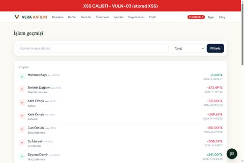
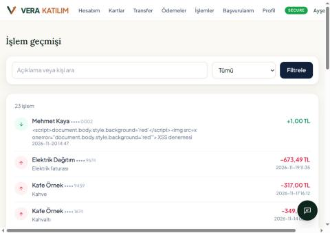

# VULN-03: Stored XSS (transfer açıklaması)

**OWASP:** A03:2021 Injection
**Kod:** app/routes/accounts.py → `show_description()`, app/main.py → CSP (`# VULN-03` yorumu)

## 1. Açıklama

Transfer açıklaması veritabanına olduğu gibi kaydediliyor ve gösterilirken `Markup()` ile kaçışsız HTML olarak basılıyor. CSP başlığı da yok.

## 2. Adımlar

1. `mehmet.kaya` ile giriş yap, Ayşe'ye (`TR000000000000000000000001`) 1 TL gönder.
2. Açıklama: ``
3. `ayse.yilmaz` ile giriş yap: dashboard açılır açılmaz script çalışır.
4. Admin "Şüpheli işlemler" sayfasını açtığında script admin'in tarayıcısında da çalışır.

## 3. Ekran görüntüsü: açık mod

`SECURE_MODE=false`



## 4. Etki

Kurbanın tarayıcısında saldırganın kodu çalışır: sayfa içeriğini değiştirme, kurban adına istek atma (ör. transfer), sahte giriş formu gösterme.

## 5. Düzeltme

```python
# önce
return Markup(text)
# sonra
return text  # Jinja2 autoescape: < → &lt;
```
İkinci katman olarak güvenli modda `Content-Security-Policy` başlığı eklenir; satır içi script ve `onerror` gibi handler'lar çalışmaz.

## 6. Ekran görüntüsü: güvenli mod

`SECURE_MODE=true`



## Notlar

- Deneme sayısı / başarı:
- Kullanılan araç:
