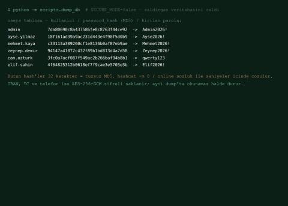
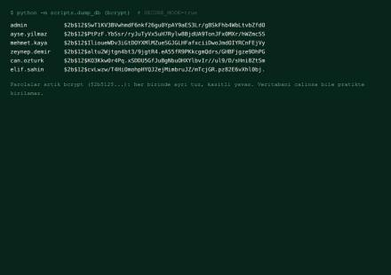

# VULN-05: Zayıf parola saklama (MD5)

**OWASP:** A02:2021 Cryptographic Failures
**Kod:** app/auth.py → `hash_password()` (`# VULN-05` yorumu)

## 1. Açıklama

Parolalar tuzsuz MD5 ile saklanıyor. Aynı parola her zaman aynı hash'i verir ve MD5 GPU ile saniyede milyarlarca kez hesaplanabilir.

## 2. Adımlar

1. `SECURE_MODE=false` ile `python -m scripts.seed` çalıştır.
2. `python -m scripts.dump_db` ile `password_hash` sütununa bak: 32 karakterlik hex değerler.
3. `can.ozturk`'un hash'ini bir MD5 sözlüğünde veya `hashcat -m 0` ile ara: `qwerty123` anında bulunur.
4. `SECURE_MODE=true` ile tekrar seed et ve dump al: hash'ler `$2b$12$...` ile başlar.

## 3. Ekran görüntüsü: açık mod

`SECURE_MODE=false`



## 4. Etki

Veritabanı sızarsa parolaların çoğu dakikalar içinde kırılır. Kullanıcılar aynı parolayı başka yerlerde de kullandığı için zarar bankanın dışına taşar.

## 5. Düzeltme

```python
# önce
return hashlib.md5(password.encode()).hexdigest()
# sonra
return bcrypt.hashpw(password.encode(), bcrypt.gensalt(rounds=12)).decode()
```
bcrypt her parola için ayrı tuz kullanır ve bilerek yavaştır. Eski MD5 kayıtları güvenli modda ilk başarılı girişte bcrypt'e yükseltilir.

## 6. Ekran görüntüsü: güvenli mod

`SECURE_MODE=true`



## Notlar

- Deneme sayısı / başarı:
- Kullanılan araç:
